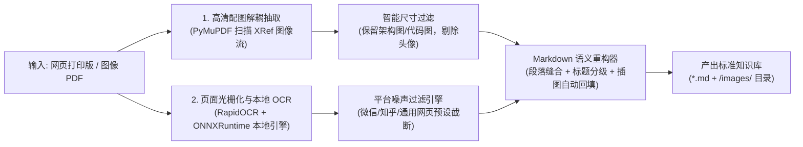

# 🚀 CleanPDF2MD

<div align="center">

**轻量级、免 GPU、零大模型依赖的“网页打印 / 图像流 PDF”转结构化 Markdown 工具**  
*Lightweight, Zero-GPU, Zero-LLM PDF-to-Markdown Converter with Smart Noise Removal and Image Anchoring*

[](https://opensource.org/licenses/MIT)
[](https://www.python.org/downloads/)
[](https://github.com/StarkL/clean-pdf2md/pulls)
[](#)
[](#)

[简体中文](./README.md) | [English](./README_EN.md)

</div>

---

## 🎯 创作者手记：AI 时代的技术文档阅读新范式

> *“在 AI 时代，逐字逐句死磕数万字枯燥的技术文档，已经不是最高效的学习方式了。将死板的 PDF 快速转换为大模型容易理解的纯净 Markdown，然后通过‘会话交流、启发式提问’的方式深度伴读，学习效率将迎来质的飞跃。”*

面对数十篇动辄上万字的长篇架构与技术教程，传统的“从头读到尾”往往枯燥低效，读到后面忘了前面。而一旦通过 **CleanPDF2MD** 将它们还原为纯净、带层级结构、带高清插图的 Markdown 格式：

1. **从“被动死读”走向“提问驱动”**：你可以直接将生成的 Markdown 丢给 AI 编程助手（如 Cursor、Claude、ChatGPT 或本地知识库），随时让大模型对不懂的代码实现与设计决策进行白话拆解；
2. **图文交互式深度解读**：正文自动关联提取的高清架构图，配合多模态大模型，能做到“指着架构图问数据流转边界与异常重试”；
3. **互动式考官与领读**：让 AI 扮演技术面试官或资深导师，基于文档重点对你发起即兴提问（例如：“*请根据第 3 节内容考考我，为什么作者在这里选择了消息队列做异步削峰？*”），在思维碰撞中秒懂技术精髓。

**CleanPDF2MD 不仅是一个格式转换工具，更是解锁“AI 对话式交互伴读”的第一道关键工序。**

---

## 💡 为什么需要 CleanPDF2MD？

在日常学习、技术调研和个人知识管理中，我们经常使用浏览器的“打印为 PDF（Print to PDF）”功能将**技术博客、网页文档、专栏长文或内网 Wiki 资料**保存为本地离线 PDF 进行归档。

然而，将这些由网页生成的 PDF 转回可编辑的 Markdown 笔记时，现有方案往往存在明显痛点：

| 现有方案 | 痛点与局限 |
| :--- | :--- |
| **重型 AI / 大模型方案** (MinerU / Marker / 多模态 LLM) | 过于沉重，依赖数 GB 的模型权重、强劲显卡（CUDA）或**高昂的大模型 API 调用费用（Token 账单）**；且会把网页底部的**网友评论、点赞在看、平台交互按钮**原封不动全部当正文排版。 |
| **传统 OCR / 提取工具** (Tesseract / pdf2text) | 仅能输出扁平碎文本，**完全丢失了原文章中最具价值的高清架构图与流程图**，且中文字符经常被分页强制断行打碎。 |

**CleanPDF2MD 专为解决这一场景而生**：**无需独立显卡，无需配置任何大模型 API Key**，依靠纯 CPU 与轻量本地 ONNX 引擎，即可将各类由网页打印生成的图像型 PDF 一键还原为**排版纯净、保留完整标题层级、自动锚定高清插图**的标准 Markdown 知识库。

---

## ✨ 核心特性

- 🔒 **零大模型依赖 & 100% 单机离线（Zero-LLM & Privacy-First）**：
  **不调用任何外部大模型 API，不需要购买 Token 或配置 API Key**。全流程在本地 CPU 单机完成，拔掉网线照样全速跑，企业级敏感资料、个人笔记绝对隐私安全，零数据泄露风险。
- ⚡ **Zero-GPU & 纯 CPU 极速运行**：
  基于 ONNXRuntime 多核并发加速，无需 NVIDIA 显卡或 PyTorch，普通办公笔记本即可秒级运行。
- 🖼️ **图文解耦与原图自动锚定（Killer Feature）**：
  直接扫描 PDF 底层 XRef 二进制流提取原始分辨率的无损架构图（自动过滤装饰小点阵与头像图标），并在 Markdown 正文对应段落自动回填相对路径语法 ``。
- 🧹 **平台专有噪声智能截断（Smart Truncation）**：
  内置平台规则引擎，自动识别并过滤页眉的作者栏、发布日期、定位标签，并在文末“互动区、点赞评论、外链导航”处精准截断，产出纯粹的技术干货。
- 🔗 **中文自然段落缝合（Paragraph Healing）**：
  智能识别并缝合跨行换行截断的中文字符，并根据规律自动推断与重塑 `#`、`##`、`###` 标题体系。
- 🔄 **断点续转机制（Checkpointing）**：
  批量转换上百篇文档时，自动跳过已完成的文件，支持随时暂停与秒级增量处理。

---

## 🛠️ 处理流水线架构



---

## 📦 快速安装

### 方式一：从源码安装（推荐）

```bash
git clone https://github.com/StarkL/clean-pdf2md.git
cd clean-pdf2md
pip install -e .
```

### 方式二：直接安装依赖

```bash
pip install -r requirements.txt
```

---

## 🚀 命令行 CLI 使用指南

安装后可直接在终端中运行 `clean-pdf2md` 命令：

### 1. 转换单篇技术文档
```bash
clean-pdf2md ./article.pdf -o ./output/ --preset wechat
```

### 2. 批量转换整个目录
```bash
clean-pdf2md ./my_pdfs/ -o ./my_markdown/ --preset wechat
```

### 3. CLI 参数完整说明

| 参数 | 缩写 | 默认值 | 说明 |
| :--- | :--- | :--- | :--- |
| `input` | | *必填* | 输入 PDF 文件路径或包含 PDF 的目录路径 |
| `--output` | `-o` | `./output_markdown` | 输出的 Markdown 及配图目录 |
| `--preset` | `-p` | `wechat` | 预设清理规则：`wechat`（微信公众号网页）、`zhihu`（知乎文章）、`generic`（通用网页/打印件） |
| `--overwrite` | | `False` | 是否覆盖已转换过的文件（默认启用断点续传跳过） |
| `--dpi` | | `150` | OCR 页面光栅化渲染分辨率 |
| `--min-width` | | `250` | 提取配图的最小宽度（像素，用于过滤小图标） |
| `--min-height`| | `150` | 提取配图的最小高度（像素） |
| `--min-size`  | | `12000` | 提取配图的最小字节大小（字节，用于过滤头像） |

---

## 🐍 Python API 代码调用

你也可以将 `clean_pdf2md` 作为 Python 库直接嵌入到你的 RAG、个人知识库（Obsidian / Notion）或数据预处理流水线中：

```python
from clean_pdf2md import CleanPDFConverter

# 初始化转换引擎，选用微信文章预设 (完全本地运行，无需 API Key)
converter = CleanPDFConverter(preset="wechat", dpi=150)

# 转换单篇文档
success, out_path, msg = converter.convert(
    pdf_path="path/to/article.pdf",
    output_dir="./output_dir"
)
print(f"转换状态: {msg}, 生成文档: {out_path}")

# 批量转换整个目录
results = converter.convert_batch(
    input_dir="./docs_pdf/",
    output_dir="./docs_markdown/"
)
```

---

## 🧩 扩展自定义清洗预设（Custom Presets）

想要适配其他平台或个人技术博客？只需继承 `BasePreset`：

```python
from clean_pdf2md.presets.base import BasePreset
from clean_pdf2md import CleanPDFConverter

class MyCustomPreset(BasePreset):
    name = "my_custom"

    def should_filter_header(self, text: str, page_num: int) -> bool:
        # 首页面眉噪声过滤
        return page_num == 0 and ("阅读时长" in text or "作者：" in text)

    def is_content_cutoff(self, text: str, page_num: int) -> bool:
        # 正文末尾评论截断
        return "评论区" in text or "相关推荐" in text

# 使用自定义预设
converter = CleanPDFConverter(custom_preset=MyCustomPreset())
```

---

## ⚖️ 免责声明 (Disclaimer)

1. 本工具仅定位为通用的**个人离线文档格式转换与知识管理（PKM）辅助工具**。
2. 请在法律与版权允许的范围内使用本工具，转换内容须符合相关平台的使用条款与知识产权法规。
3. 请仅对个人拥有合法阅读权限、已获授权或公开归档的技术资料进行转换，严禁用于任何形式的侵权传播或非法牟利行为。

---

## 📄 开源许可证

本项目基于 [MIT License](./LICENSE) 协议开源。欢迎 Star 🌟、提交 Issue 或提交 Pull Request！
