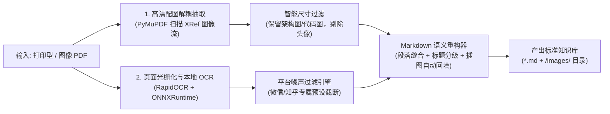

# 🚀 CleanPDF2MD

<div align="center">

**轻量级、免 GPU 的“打印型 / 网页图像型 PDF”转结构化 Markdown 工具**  
*Lightweight, Zero-GPU PDF-to-Markdown Converter with Smart Noise Removal and Image Anchoring*

[](https://opensource.org/licenses/MIT)
[](https://www.python.org/downloads/)
[](https://github.com/your-username/clean-pdf2md/pulls)
[](#)

[简体中文](./README.md) | [English](./README_EN.md)

</div>

---

## 💡 为什么需要 CleanPDF2MD？

在面对**从网页打印导出的 PDF**（如**微信公众号付费文章、知识星球、知乎盐选、专栏、内网文档**）时，现有开源方案存在明显的痛点：

| 现有方案 | 痛点与局限 |
| :--- | :--- |
| **重型 AI 方案** (MinerU / Marker / Docling) | 极其沉重，依赖数 GB 的模型权重与强劲显卡（CUDA），且会把文末几十条**网友评论、点赞、在看、已付费标记**原封不动当正文排版。 |
| **爬虫类网页抓取** (Puppeteer 等) | 对**已付费、需登录鉴权或防复制**的文章完全失效，外部无法通过 URL 直接抓取。 |
| **传统 OCR / 提取工具** (Tesseract / pdf2text) | 只输出碎片纯文本，**完全丢弃了原文章中最具价值的高清架构图与流程图**，且中文字符被无序换行打碎。 |

**CleanPDF2MD 踩中了这一生态空白**：专为打印版 / 图像流 PDF 打造，仅利用纯 CPU 与几十 MB 的轻量 ONNX 依赖，即可一键输出**纯净、带清晰层级标题、自动嵌入高清配图**的标准 Markdown 知识库。

---

## ✨ 核心特性

- ⚡ **Zero-GPU & 纯 CPU 极速运行**：基于 ONNXRuntime 多核并发加速，无需 NVIDIA 显卡或 PyTorch，普通办公笔记本即可秒级运行。
- 🖼️ **图文解耦与原图自动锚定（Killer Feature）**：
  直接扫描 PDF 底层 XRef 二进制流提取原始分辨率的无损架构图（自动过滤装饰小点阵与头像），并在 Markdown 正文对应段落自动回填相对路径语法 ``。
- 🧹 **平台专有噪声物理切除（Smart Truncation）**：
  内置平台规则引擎，自动剔除页眉“已付费、原创作者、时间、阅读数”，并在文末“写留言、点赞、在看、网友盖楼”处精准截断，输出 100% 纯技术干货。
- 🔗 **中文排版缝合（Paragraph Healing）**：
  智能识别并缝合跨行换行截断的中文字符，并根据规律自动推断与重塑 `#`、`##`、`###` 标题体系。
- 🔄 **断点续转机制（Checkpointing）**：
  批量转换上百篇文档时，自动跳过已完成的文件，支持随时暂停与秒级增量处理。

---

## 🛠️ 处理流水线架构



---

## 📦 快速安装

### 方式一：从源码安装（推荐）

```bash
git clone https://github.com/your-username/clean-pdf2md.git
cd clean-pdf2md
pip install -e .
```

### 方式二：直接安装依赖

```bash
pip install -r requirements.txt
```

---

## 🚀 命令行 CLI 使用指南

安装后可直接在终端中运行 `clean-pdf2md` 命令：

### 1. 转换单篇文档
```bash
clean-pdf2md ./article.pdf -o ./output/ --preset wechat
```

### 2. 批量转换整个目录
```bash
clean-pdf2md ./my_pdfs/ -o ./my_markdown/ --preset wechat
```

### 3. CLI 参数完整说明

| 参数 | 缩写 | 默认值 | 说明 |
| :--- | :--- | :--- | :--- |
| `input` | | *必填* | 输入 PDF 文件路径或包含 PDF 的目录路径 |
| `--output` | `-o` | `./output_markdown` | 输出的 Markdown 及配图目录 |
| `--preset` | `-p` | `wechat` | 预设清理规则：`wechat`（微信公众号）、`zhihu`（知乎）、`generic`（通用） |
| `--overwrite` | | `False` | 是否覆盖已转换过的文件（默认启用断点续传跳过） |
| `--dpi` | | `150` | OCR 页面光栅化渲染分辨率 |
| `--min-width` | | `250` | 提取配图的最小宽度（像素，用于过滤小图标） |
| `--min-height`| | `150` | 提取配图的最小高度（像素） |
| `--min-size`  | | `12000` | 提取配图的最小字节大小（字节，用于过滤头像） |

---

## 🐍 Python API 代码调用

你也可以将 `clean_pdf2md` 作为 Python 库直接嵌入到你的 RAG、知识库或数据预处理流水线中：

```python
from clean_pdf2md import CleanPDFConverter

# 初始化转换引擎，选用微信预设
converter = CleanPDFConverter(preset="wechat", dpi=150)

# 转换单篇文档
success, out_path, msg = converter.convert(
    pdf_path="path/to/article.pdf",
    output_dir="./output_dir"
)
print(f"转换状态: {msg}, 生成文档: {out_path}")

# 批量转换整个目录
results = converter.convert_batch(
    input_dir="./docs_pdf/",
    output_dir="./docs_markdown/"
)
```

---

## 🧩 扩展自定义清洗预设（Custom Presets）

想要适配其他平台（如掘金、简书、知识星球）？只需继承 `BasePreset`：

```python
from clean_pdf2md.presets.base import BasePreset
from clean_pdf2md import CleanPDFConverter

class MyCustomPreset(BasePreset):
    name = "my_custom"

    def should_filter_header(self, text: str, page_num: int) -> bool:
        # 首页面眉噪声过滤
        return page_num == 0 and ("阅读时长" in text or "作者：" in text)

    def is_content_cutoff(self, text: str, page_num: int) -> bool:
        # 正文末尾评论截断
        return "评论区" in text or "推荐阅读" in text

# 使用自定义预设
converter = CleanPDFConverter(custom_preset=MyCustomPreset())
```

---

## ⚖️ 免责声明 (Disclaimer)

1. 本工具仅作为通用的本地文档格式转换与个人离线笔记整理工具。
2. 使用本工具处理的内容请遵守当地知识产权法规与相关平台的服务协议。
3. 请仅对个人已合法购买、获得授权或公开归档的文档进行转换，严禁用于侵权传播或商业盗版。

---

## 📄 开源许可证

本项目基于 [MIT License](./LICENSE) 协议开源。欢迎 Star 🌟、提交 Issue 或提交 Pull Request！
